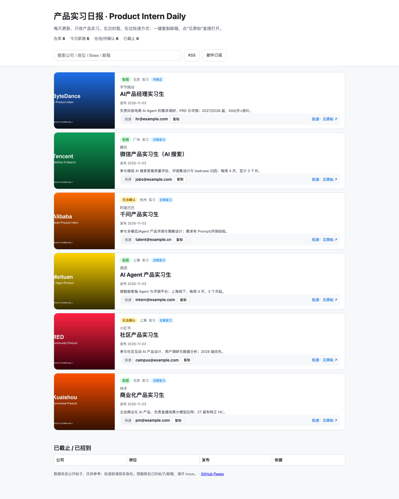

# Product Intern Daily · 产品实习日报

> **找产品实习，只用看这个。**
>
> **每日更新，免费邮箱订阅。** 可以部署到本地，自行修改搜索逻辑。来源：小红书。

[](https://www.python.org/)
[](LICENSE)
[](.github/workflows/ci.yml)



---

## 每日更新与免费订阅

- **邮件订阅**：每天一封，只发产品实习；免费，不卖邮箱。
- **订阅页**：[subscribe.html](docs/subscribe.html)
- 邮件服务用 Buttondown / Resend / Listmonk，不用私人 Gmail/QQ；配置见 [docs/SUBSCRIBE.md](docs/SUBSCRIBE.md)。

> 订阅是免费的。这个项目不靠卖岗位表赚钱。

---

## 为什么做这个

面试已经很累了，不要让信息来源成为找实习的负担。

### 1. 三个渠道是互补的

小红书、招聘平台、官网是三个互补的渠道：

- 招聘平台/官网项目多、流程正式，但一个岗位要填很多信息；
- 小红书更像组内直招/急招/继任，流程短，能直接找到人；
- 这块目前还比较空缺，信息散、重复多。

后续也会接入其他几个平台。

### 2. “最新”不等于“相关”

- 首页推荐有时效，但刷多了全是岗位，想看别的都刷不到；
- 搜索按时间排序精度低，旧帖、面经、引流、已截止混在一起；
- 我们抽样 100 条：**只有 10 条能拿到投递邮箱**。

### 3. 提取成本高

公司、岗位、Base、邮箱、是否在招、是否可转正，散在标题、正文、评论区、图片和置顶评论里。  
人工一天看 20 条就到极限。

### 4. 为什么用免费邮件订阅

我自己也在找产品实习，看到不少人把搜集来的信息整理成表格卖钱。  
所以这里不卖数据：**每日更新 + 免费邮箱订阅**，把信息差尽量抹平。

---

<!-- JOBS:START -->
## 在招岗位（17）

> 最近更新：2026-11-03 21:38 · 只列产品实习；投递前请核实身份。

| 公司 | 岗位 | Base | 投递 | 状态 | 转正 | 发布 |
|---|---|---|---|---|---|---|
| 快手 | [策略产品](https://www.xiaohongshu.com/explore/6ae9b790000000001e0171f2?xsec_token=ABzWbnm3n7ma9LlmX9s8Vso1PnZ3FDBeHfq3agR3e2zhA=&xsec_source=pc_search) | 北京 | [yuanzheng03@kuaishou.com](mailto:yuanzheng03@kuaishou.com) | 无法确认 | 日常实习 | 2026-11-03 |
| 快手 | [AI产品实习生](https://www.xiaohongshu.com/explore/6ae9a7f10000000015020253?xsec_token=ABzWbnm3n7ma9LlmX9s8Vso5jnN6x0ifit8RAyNxDkShE=&xsec_source=pc_search) | 北京 | [wujingyi10@kuaishou.com](mailto:wujingyi10@kuaishou.com) | 无法确认 | 日常实习 | 2026-11-03 |
| 未识别 | [爱奇艺会员产品实习生](https://www.xiaohongshu.com/explore/6ae99e57000000000e00d732?xsec_token=ABzWbnm3n7ma9LlmX9s8Vso4Q74XNF-gp6VVXIebnfiOY=&xsec_source=pc_search) | 待确认 | [liqinyuan@qiyi.com](mailto:liqinyuan@qiyi.com) | 无法确认 | 日常实习 | 2026-11-03 |
| 快手 | [策略产品实习生 招非应届](https://www.xiaohongshu.com/explore/6ae96737000000001a016af5?xsec_token=ABzWbnm3n7ma9LlmX9s8Vso2reoVBLM8nVgJO-XC-ySmo=&xsec_source=pc_search) | 北京 | [weijuanxia@kuaishou.com](mailto:weijuanxia@kuaishou.com) | 无法确认 | 日常实习 | 2026-11-03 |
| 快手 | [策略产品实习 要求非应届](https://www.xiaohongshu.com/explore/6ae966cb000000001601195d?xsec_token=ABzWbnm3n7ma9LlmX9s8Vso20Bb9ZlsinN1Q8M1fV64mQ=&xsec_source=pc_search) | 北京 | [weijuanxia@kuaishou.com](mailto:weijuanxia@kuaishou.com) | 无法确认 | 日常实习 | 2026-11-03 |
| 快手 | [AI产品实习生](https://www.xiaohongshu.com/explore/6ae8adc00000000034003cba?xsec_token=ABgmRiJtot2F9S8Co72Ad2o1sLPnlyjiRVRbPDsxN0XXU=&xsec_source=pc_search) | 北京 | [zhanjinjin05@kuaishou.com](mailto:zhanjinjin05@kuaishou.com) | 无法确认 | 日常实习 | 2026-11-02 |
| 未识别 | [agent 产品实习生](https://www.xiaohongshu.com/explore/6ae9c1d3000000001401eb9d?xsec_token=ABzWbnm3n7ma9LlmX9s8Vsoxf3BLM-EcSl1gCAagUfJJE=&xsec_source=pc_search) | 远程 | [见原帖](https://www.xiaohongshu.com/explore/6ae9c1d3000000001401eb9d?xsec_token=ABzWbnm3n7ma9LlmX9s8Vsoxf3BLM-EcSl1gCAagUfJJE=&xsec_source=pc_search) | 无法确认 | 日常实习 | 2026-11-03 |
| 未识别 | [AI 产品实习生招聘（金融 AI](https://www.xiaohongshu.com/explore/6ae9ba16000000001402903d?xsec_token=ABzWbnm3n7ma9LlmX9s8Vso0OIwx7bi2seg4X_A99wWcM=&xsec_source=pc_search) | 深圳 | [见原帖](https://www.xiaohongshu.com/explore/6ae9ba16000000001402903d?xsec_token=ABzWbnm3n7ma9LlmX9s8Vso0OIwx7bi2seg4X_A99wWcM=&xsec_source=pc_search) | 无法确认 | 日常实习 | 2026-11-03 |
| 百度 | [产品运营岗找实习](https://www.xiaohongshu.com/explore/6ae9b559000000000e035c6a?xsec_token=ABzWbnm3n7ma9LlmX9s8Vso6SG8AeyQfzLtjwEw3po_H0=&xsec_source=pc_search) | 北京 / 深圳 | [见原帖](https://www.xiaohongshu.com/explore/6ae9b559000000000e035c6a?xsec_token=ABzWbnm3n7ma9LlmX9s8Vso6SG8AeyQfzLtjwEw3po_H0=&xsec_source=pc_search) | 无法确认 | 日常实习 | 2026-11-03 |
| 快手 | [直播流量策略产品](https://www.xiaohongshu.com/explore/6ae99d060000000003022139?xsec_token=ABzWbnm3n7ma9LlmX9s8Vso4-oTjVu3YLEeiW4nV7wEeU=&xsec_source=pc_search) | 北京 | [见原帖](https://www.xiaohongshu.com/explore/6ae99d060000000003022139?xsec_token=ABzWbnm3n7ma9LlmX9s8Vso4-oTjVu3YLEeiW4nV7wEeU=&xsec_source=pc_search) | 无法确认 | 日常实习 | 2026-11-03 |
| 小米 | [可穿戴部门软件产品实习生](https://www.xiaohongshu.com/explore/6ae9837a000000000602c0e4?xsec_token=ABzWbnm3n7ma9LlmX9s8Vso6Jp8wQse2t8oco-98yUaVM=&xsec_source=pc_search) | 北京 | [见原帖](https://www.xiaohongshu.com/explore/6ae9837a000000000602c0e4?xsec_token=ABzWbnm3n7ma9LlmX9s8Vso6Jp8wQse2t8oco-98yUaVM=&xsec_source=pc_search) | 无法确认 | 日常实习 | 2026-11-03 |
| 快手 | [直播流量策略产品找实习生](https://www.xiaohongshu.com/explore/6ae977d700000000030074d8?xsec_token=ABzWbnm3n7ma9LlmX9s8Vso6dtzEvc2UtrpG6LaOJrppw=&xsec_source=pc_search) | 北京 | [见原帖](https://www.xiaohongshu.com/explore/6ae977d700000000030074d8?xsec_token=ABzWbnm3n7ma9LlmX9s8Vso6dtzEvc2UtrpG6LaOJrppw=&xsec_source=pc_search) | 无法确认 | 日常实习 | 2026-11-03 |
| 腾讯 | [AI搜索产品经理实习](https://www.xiaohongshu.com/explore/6ae95bac0000000007000482?xsec_token=ABzWbnm3n7ma9LlmX9s8Vso1GqbpkabCxFUnxUN490L-4=&xsec_source=pc_search) | 北京 | [见原帖](https://www.xiaohongshu.com/explore/6ae95bac0000000007000482?xsec_token=ABzWbnm3n7ma9LlmX9s8Vso1GqbpkabCxFUnxUN490L-4=&xsec_source=pc_search) | 无法确认 | 日常实习 | 2026-11-03 |
| 未识别 | [中银基金产品实习](https://www.xiaohongshu.com/explore/6ae93c38000000000e00e3b0?xsec_token=ABzWbnm3n7ma9LlmX9s8Vso3oH1oFQGelxouurc4u8wTA=&xsec_source=pc_search) | 上海 | [见原帖](https://www.xiaohongshu.com/explore/6ae93c38000000000e00e3b0?xsec_token=ABzWbnm3n7ma9LlmX9s8Vso3oH1oFQGelxouurc4u8wTA=&xsec_source=pc_search) | 无法确认 | 日常实习 | 2026-11-03 |
| 未识别 | [航旅纵横 产品经理实习生](https://www.xiaohongshu.com/explore/6ae8bc0e0000000037038aa4?xsec_token=ABgmRiJtot2F9S8Co72Ad2o_tuxhBbCJBiv9as68shU_g=&xsec_source=pc_search) | 北京 | [见原帖](https://www.xiaohongshu.com/explore/6ae8bc0e0000000037038aa4?xsec_token=ABgmRiJtot2F9S8Co72Ad2o_tuxhBbCJBiv9as68shU_g=&xsec_source=pc_search) | 在招 | 可转正 | 2026-11-03 |
| 腾讯 | [啦 组内直推AI Infra 产品实习生](https://www.xiaohongshu.com/explore/6ae878a9000000003303b080?xsec_token=ABgmRiJtot2F9S8Co72Ad2o1TWofIkkhDM0BtVExtKh2k=&xsec_source=pc_search) | 深圳 | [见原帖](https://www.xiaohongshu.com/explore/6ae878a9000000003303b080?xsec_token=ABgmRiJtot2F9S8Co72Ad2o1TWofIkkhDM0BtVExtKh2k=&xsec_source=pc_search) | 无法确认 | 日常实习 | 2026-11-02 |
| 百度 | [AI搜索产品实习大模型](https://www.xiaohongshu.com/explore/6ae87478000000003602b9b7?xsec_token=ABgmRiJtot2F9S8Co72Ad2o6TCaEI-Fj7WhGKwxzxy168=&xsec_source=pc_search) | 北京 | [见原帖](https://www.xiaohongshu.com/explore/6ae87478000000003602b9b7?xsec_token=ABgmRiJtot2F9S8Co72Ad2o6TCaEI-Fj7WhGKwxzxy168=&xsec_source=pc_search) | 无法确认 | 日常实习 | 2026-11-02 |
<!-- JOBS:END -->

## 快速开始

这个项目做三件事：

1. 从公开帖子拉取产品实习线索；
2. 用 Agent 抽取公司/岗位/Base/邮箱/状态/转正；
3. 生成页面和每日邮件。

### 前置

本地启动 [`xiaohongshu-mcp`](https://github.com/xpzouying/xiaohongshu-mcp)，并完成扫码登录。

### 安装

```bash
python3 -m venv .venv
. .venv/bin/activate
pip install -e .

# 可选：图片 OCR（macOS）
pip install -e ".[ocr]"
```

### 跑起来

```bash
# 检查 MCP / 登录 / OCR / DB
python run.py doctor

# 也可以先生成配置（不需要手改文件）
python run.py init

# 搜索 → 详情 → 抽取任务
python run.py search --keyword "产品实习" --keyword "产品继任" --keyword "互联网产品" \
  --sort 最新 --publish-time 一天内 --note-type 图文 --out candidates.json
python run.py fetch candidates.json --out details --ocr
python run.py extract --details details --out tasks.json --prepare

# 让 Codex/DSH 按 prompts/extract.md 读 tasks.json，写 extractions.json
python run.py extract --import-file extractions.json --details details

# 导出
python run.py export --format csv,html,json --out exports
```

每日自动更新：见 [docs/SCHEDULE.md](docs/SCHEDULE.md)。

---

## 能做什么

- **每日 3 个关键词**：产品实习、产品继任、互联网产品；不做 Base × 时间矩阵。
- **投递方式**：邮箱、内推码、评论/图片/置顶评论里的邮箱，一键复制纯邮箱。
- **状态与转正**：在招/无法确认、已截止；可转正/日常实习，带原话证据。
- **输出**：CSV、HTML、每日邮件；邮箱优先去重。

---

## 技术细节

### 搜索与时间

`sort_by=最新` 会牺牲相关性；用 `publish_time=一天内/一周内/半年内` 先筛，再用 `note.time` 精确排序。  
一次搜索约 20 条，没有 page/cursor，所以用少量关键词轮换，不堆同义词。

### Agent 抽取

`extract --prepare` 生成 `tasks.json`，包含标题、正文、评论、OCR、图片和 schema。  
Codex/DSH 按 [prompts/extract.md](prompts/extract.md) 输出严格 JSON；**不需要额外 LLM API Key**。

### 去重与状态

- 去重：`email` → `company+position` → `post_id`；
- 状态：`在招 / 无法确认`，已截止写 `closed=true`；
- 转正：出现“可转正/转正HC/留用” → 可转正；出现“无转正/无HC” → 日常；否则默认日常。

### 过滤

排除购买表格/同款/付费引流、面经/求助、多公司引流；保留有内推码但没邮箱的岗位。  
规则在 `src/product_intern_daily/filters.py`，可自行改。

### OCR

macOS 用 `sips` + `ocrmac`（Apple Vision），默认原图 + 180° 旋转 + 水平/垂直翻转。  
纯图片置顶评论需要 patched `xiaohongshu-mcp`，见 [docs/XHS_MCP_PATCH.md](docs/XHS_MCP_PATCH.md)。

### 每日调度

本地 `launchd`/cron 跑 `scripts/daily.sh`：

```text
3 关键词 → 2 并发、40–60 条 → OCR → 筛选 → 合并 jobs.json → 生成 docs
```

GitHub-hosted Actions 不能登录小红书；Cookie 不要进 Secrets。  
完整方案见 [docs/SCHEDULE.md](docs/SCHEDULE.md)。

### 风险与合规

- 仅用于个人求职研究，遵守小红书用户协议；
- 用小号采集，2–3 并发、3–8 秒间隔；出现 461/验证码立即停；
- 邮箱属于个人信息，投递前核实身份；
- 本项目与小红书官方无隶属关系。

---

## 如果这个项目帮你省了时间

- 点个 **Star**；
- 订阅 [邮件](docs/subscribe.html)；
- 发现好帖子/错误信息，用 [Issue 模板](.github/ISSUE_TEMPLATE/new-job.yml) 提交；
- 想自己跑：clone + 自己的 `xiaohongshu-mcp` + 自己的 Cookie。

## Roadmap

- [x] 产品实习字段：公司/岗位/Base/邮箱/内推码/状态/转正
- [x] 多图 OCR + 翻转 + 评论邮箱 + 置顶评论
- [x] 静态页 + 每日邮件 dry-run
- [x] Issue 模板 + CI
- [ ] 第二数据源（公众号/官网/牛客）
- [ ] 每周产品实习报告

## License

MIT。依赖 [`xiaohongshu-mcp`](https://github.com/xpzouying/xiaohongshu-mcp)（Apache-2.0），本项目不包含其代码。
